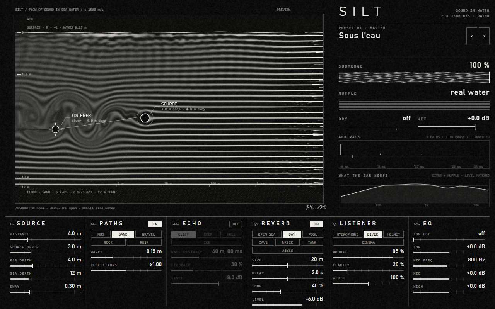

# SILT — sound under water



A VST3 effect that takes sounds recorded in air (a microphone, a sample, a whole mix) and
puts them under water — realistically, and with controls to push it further. It only
**transforms** the sound it receives; nothing is generated. It is made to drop on a master
bus and work at once: zero latency, level-matched, a ready starting preset.

Why "reverb + delay + low-pass" never sounds right: it matches neither the physics of water
nor how a head under water hears. SILT models both, separately.

**Download:** see [Releases](../../releases) (Windows x64, macOS universal).

*Formerly named FATHOM.* SILT keeps FATHOM's VST3 ID and state format: sessions saved with FATHOM open in SILT with every setting (checked by `silt_hosttest --compat`). Remove `FATHOM.vst3` from your VST3 folder when installing SILT.

## What the physics says (and what SILT does with it)

| Fact | Consequence | Where |
|---|---|---|
| Sound travels at **1500 m/s** in water, 4.4× faster than in air | Echoes and reverberation are 4.4× tighter: a 10 m pool sounds small and dense. An air reverb never fits | PATHS, ECHO, REVERB |
| Water absorbs **almost nothing** over the distances of a scene (Francois–Garrison: 0.06 dB/km at 1 kHz, 1 dB/km at 10 kHz) | The muffling comes from **the ear**. Real absorption is always computed; MUFFLE lets you overdo it | SOURCE, MUFFLE |
| The surface reflects sound **inverted** (−1), the floor reflects part of it (sand ≈ 0.4, mud ≈ 0.2, rock ≈ 0.7, total reflection below the critical angle) | A source near the surface loses its lows (Lloyd's mirror); a shallow bay makes a comb of paths | PATHS (image method, 48 paths) |
| Waves **scatter the treble** of every surface bounce and keep it moving | Surface bounces are darker and waver: the liquid shimmer, physical, not a chorus | PATHS (WAVES) |
| The water column is a **waveguide**: below f = c / (4H√(1−c²/c_floor²)) sound does not carry far | A distant source in shallow water loses its lows (sand, 10 m of water: ≈ 76 Hz) | PATHS (automatic) |
| A far wall returns sound after **2d / c** | 75 m → 100 ms (in air: 437 ms). Each return loses the treble the wall scatters and the path absorbs | ECHO |
| A head under water hears **through the bones**: sensitivity is a broad bowl centred on 0.4–1 kHz, the flooded ear canal loses its 3 kHz resonance, the stereo image collapses (interaural time ÷ 4.4, no head shadow) | The diver's sound: a wide dip around 3 kHz, soft highs, the image inside the head | LISTENER (DIVER) |

What is **film convention** rather than physics: the steep resonant low-pass, the big lush
reverb, the pitch-down. It is available (CINEMA ear, MUFFLE pushed) because audiences expect
it, but it is not the default. The *Aquaman* lesson: real physics makes dialogue
unintelligible — hence CLARITY.

## Controls

- **SUBMERGE** — from the surface (0 %) to under water (100 %), equal-power. The ear closes
  as it goes: automate it for a plunge.
- **MUFFLE** — at 0, real water. Turning it up brings a steep low-pass (24 dB/oct) down to
  90 Hz with a soft pressure bump under the corner. Level-matched: it changes the colour, not
  the loudness. It also darkens the echo and the reverb tail.
- **DRY / WET** — WET sets the level of the effect (−48 to +12 dB). DRY adds the original
  sound in parallel, whatever SUBMERGE says (off by default).
- **i. SOURCE** — distance (30 cm to 10 km), source depth, listener depth and sea depth
  **down to 11 km** (Mariana Trench), SWAY (the source drifts).
- **ii. PATHS** — sea floor, waves, reflection level (×1 = physical).
- **iii. ECHO** — a wall (cliff, reef, ringing steel hull, ice), its distance, feedback
  (bouncing between two walls), level. Returns alternate left / right.
- **iv. REVERB** — 16-line feedback delay network with delays computed at 1500 m/s. Spaces:
  open sea, bay, pool, cave, wreck, tank, abyss. Size, decay (up to 20 s), tone, level.
- **v. LISTENER** — hydrophone, diver, helmet, cinema; AMOUNT, CLARITY, WIDTH. Level-matched.
- **vi. EQ** (on the wet) — low cut, low shelf, sweepable mid, high shelf.

**The plate** is drawn after old flow-visualisation photographs: the current runs from the
source to the listener, smoke filaments bend around both bodies and shed a vortex wake that
grows with the level of the sound. Waves rock the filaments near the surface; MUFFLE blurs
them into smoke. Drag the **source** (distance and depth) and the **listener** (depth); the
mouse wheel over the plate sets the depth of the sea. The paths are dotted (tight dots = an
inverted arrival).

## Presets

MASTER: Sous l'eau (the starting point) · Profond · Étouffé à fond.
SCÈNE: Plongeon · Nage près de la surface · Sirène, voix proche · Sirène, chant lointain ·
Coquille géante · Fonds marins qui bougent.
LIEU: Récif · Grotte sous-marine · Épave · Piscine · Aquarium · Sous la banquise ·
Haute mer, 1 km · Abysses, 4000 m · Fosse des Mariannes.
ÉCOUTE: Hydrophone documentaire · Scaphandre · Cinéma classique.

## Install

- **Windows:** unzip, copy `SILT.vst3` into `C:\Program Files\Common Files\VST3\` (host
  closed), then rescan plug-ins in your host.
- **macOS:** unzip, copy `SILT.vst3` into `~/Library/Audio/Plug-Ins/VST3/`. The plugin is
  not notarized yet, so run once in Terminal:
  `xattr -dr com.apple.quarantine ~/Library/Audio/Plug-Ins/VST3/SILT.vst3`, then rescan.

## Build

Requirements: CMake ≥ 3.22, a C++20 compiler (Visual Studio 2022 on Windows, Xcode on macOS),
Git. On Windows, the WebView2 SDK:

```
nuget install Microsoft.Web.WebView2 -OutputDirectory C:\webview2
cmake -S . -B build -A x64 -DJUCE_WEBVIEW2_PACKAGE_LOCATION=C:\webview2
cmake --build build --config Release --target Silt_VST3 silt_hosttest silt_render
build\plugin\silt_hosttest_artefacts\Release\silt_hosttest.exe build\plugin\Silt_artefacts\Release\VST3\SILT.vst3
```

JUCE 8 is fetched by CMake (set `FETCHCONTENT_SOURCE_DIR_JUCE` to reuse a local copy).

| Folder | Contents |
|---|---|
| [`dsp/include/silt/`](dsp/include/silt) | C++20 DSP core, header-only, no dependencies: image-method paths, echo, 16-line reverb, listener, MUFFLE / EQ, sea-water absorption |
| [`plugin/Source/`](plugin/Source) | Parameter table, presets, the JUCE-free engine, JUCE processor and WebView editor |
| [`design/ui.html`](design/ui.html) | The interface, embedded in the plugin; it also runs on its own in a browser |
| [`plugin/HostTest/`](plugin/HostTest) | `silt_hosttest`: loads the VST3 like a DAW and stresses it |
| [`tools/render/`](tools/render) | `silt_render`: measurements (`--analyse`) and offline renders of WAV files through the presets |

## Measurements (v0.2, 48 kHz)

- Absorption: 0.056 / 0.835 / 14.5 dB/km at 1 / 10 / 50 kHz (literature: ≈ 0.06 / 1 / 15).
- Arrival times: surface 0.750 ms (theory 0.754), floor 3.25 ms (3.21), signs correct.
- Lloyd's mirror (source and listener 0.5 m deep, 20 m apart): −47 dB at 50 Hz (theory −48).
- Echo, wall at 75 m: 100.1 ms (theory 100.0).
- MUFFLE corner: 2960 / 805 / 257 / 90 Hz at 25 / 50 / 75 / 100 %.
- Level on pink noise: MASTER / Sous l'eau at 0.0 dB from the dry, the other presets within +1 / −4 dB.
- CPU: 11 to 37× faster than real time on one core, depending on the preset.
- 60 s of random settings on loud noise: always finite.
- Host test: 44.1 / 48 / 96 kHz, buffers 64 to 2048, 21 presets, state round trip: all pass.

## Sources

Francois & Garrison, JASA 72 (1982) · Jensen, Kuperman et al., *Computational Ocean
Acoustics* (Pekeris waveguide) · Eckart (rough-surface scattering) · Parvin, Nedwell et al.
(2007) and US Navy studies on underwater hearing · interviews on the sound of *Finding Nemo*,
*Aquaman*, *Deep Fear*, *Subnautica* · flow-visualisation photographs for the interface.

## Licence

SILT is free software under the **GNU General Public License v3** ([LICENSE](LICENSE)).
It uses JUCE 8 under its AGPLv3 licence. Made by **Oathr**.
